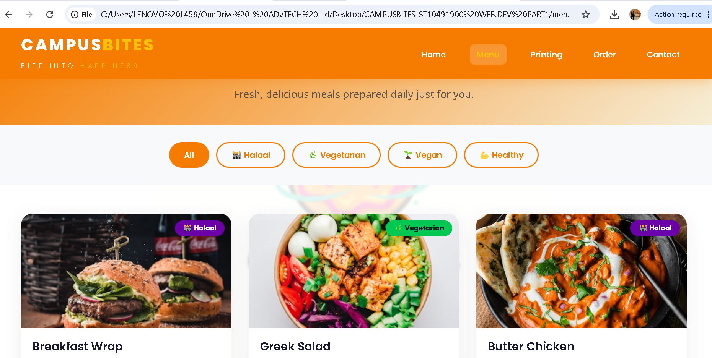
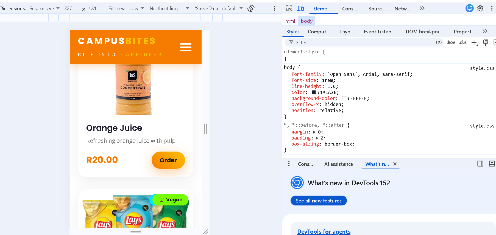
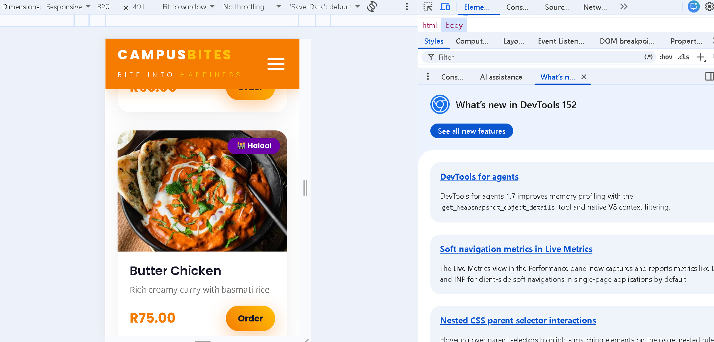

# CampusBites - Website Project

## Student Information
- **Name:** Boikanyo Mphahlele
- **Student Number:** ST10491900
- **Module:** Web Development - WEDE5020
- **Group:** 1
- **Lecturer:** Rhulani Kobeni
- **Date:** September 2026

---

## Project Overview
CampusBites is a web-based service combining **food delivery** and **document printing** for university students and staff. The service delivers directly to lecture rooms, offices, and residences. Documents are securely erased from the system within 15 minutes of delivery.

---

## Website Goals
- Provide convenient food delivery to lecture rooms, offices, and residences
- Offer secure document printing with delivery
- Reduce campus congestion and queues
- Enhance student experience and satisfaction

---

## Key Features
### Food Delivery
- Door-to-door delivery
- Real-time tracking
- In-building notifications
- Dietary labels (Halaal, Vegetarian, Vegan)

### Document Printing
- Upload & print
- Black/white & colour options
- Binding & laminating
- Secure erasure after 15 minutes

---

## Pages
| Page | Filename | Purpose |
| :--- | :--- | :--- |
| Homepage | index.html | Hero section, services, testimonials |
| Food Menu | menu.html | Food items with dietary labels |
| Printing Services | printing.html | Printing services and pricing |
| Place Order | order.html | Order form with validation |
| Contact Us | contact.html | Contact form and location map |
| About Us | about.html | Mission, vision, team, values |

---

## Technologies Used
- HTML5
- CSS3
- JavaScript
- Google Fonts (Poppins & Open Sans)
- Font Awesome Icons
- Git & GitHub

---

## File Structure

---

## Changelog

### Version 2.0 - Part 2 (September 2026)
**New Features Added:**
- Created external `style.css` stylesheet
- Added CSS reset for cross-browser consistency
- Applied typography styles using Google Fonts
- Created responsive layout using CSS Grid and Flexbox
- Added visual styles (colours, borders, shadows, hover effects)
- Implemented responsive design with media queries
- Added breakpoints for desktop, tablet, and mobile
- Used relative units (em, rem, %) for responsiveness
- Created hamburger menu for mobile navigation

**Feedback Corrections from Part 1:**
- Removed duplicate REFERENCES heading
- Fixed broken citation: (Williams, 2025)
- Added survey citation: (CampusBites Research Team, 2026)
- Standardised all references to Harvard style
- Added page numbers to all proposal pages
- Added in-text citations throughout both proposals

---

### Version 1.0 - Part 1 (August 2026)
- Created HTML structure for all 6 pages
- Implemented navigation menu across all pages
- Added placeholder content and images
- Established folder structure
- Initial commit to GitHub
- Submitted proposal documents

---

## References

### Academic Sources
Smith, J. (2025) 'Food delivery services in educational institutions', *Journal of Campus Services*, 15(2), pp. 45-62.

Johnson, M. (2024) 'Digital transformation in university services', *International Journal of Higher Education*, 22(4), pp. 112-128.

Williams, P. (2025) 'Student experience and campus convenience services', *South African Journal of Education Research*, 18(1), pp. 34-51.

### Online Sources
Hostinger (2026) *Web Hosting Pricing South Africa*. Available at: https://www.hostinger.com (Accessed: 12 August 2026).

W3Schools (2026) *HTML Web Development Tutorial*. Available at: https://www.w3schools.com (Accessed: 14 August 2026).

Mozilla Developer Network (2026) *CSS: Cascading Style Sheets*. Available at: https://developer.mozilla.org/en-US/docs/Web/CSS (Accessed: 14 August 2026).

### Survey Data
CampusBites Research Team (2026) *Student Needs Assessment Survey 2026*. Unpublished research data, [Institution Name].

---

## How to View This Website

1. Clone or download this repository
2. Open `index.html` in any modern web browser
3. Navigate using the menu links

---

## Contact
For any questions or issues, please contact:
- **Email:** info@campusbites.co.za
- **Phone:** +27 12 345 6789

---

© 2026 CampusBites. All rights reserved. | Bite Into Happiness

---

## Part 2: CSS Styling & Responsive Design

### Changes Made in Part 2

#### CSS Styling
- Created external `style.css` stylesheet linked to all HTML pages
- Added CSS reset for cross-browser consistency
- Implemented base styles (fonts, colours, spacing)
- Applied typography styles using Google Fonts (Poppins & Open Sans)
- Created responsive layout using CSS Grid and Flexbox
- Added visual styles (colours, borders, shadows, hover effects)
- Implemented button styles with gradient effects
- Created card-based layouts for services, menu, and testimonials

#### Responsive Design
- Added media queries for different screen sizes
- Implemented breakpoints: desktop (993px+), tablet (769-992px), mobile (320-768px)
- Used relative units (em, rem, %) for responsiveness
- Created hamburger menu for mobile navigation
- Added blurred logo background across all pages
- Made images responsive with max-width: 100%

#### Logo Integration
- Added CampusBites logo to header on all pages
- Added blurred logo as background watermark
- Added logo to footer on all pages

### Screenshots of Responsive Design

#### Desktop View (1200px+)

#### Tablet View (768px)

#### Mobile View (375px)

#### Mobile Menu Open

### Feedback Corrections from Part 1
- Removed duplicate REFERENCES heading
- Fixed broken citation: (Williams, 2025)
- Added survey citation: (CampusBites Research Team, 2026)
- Standardised all references to Harvard style
- Added page numbers to all proposal pages
- Added in-text citations throughout both proposals

---
# CampusBites - Part 3: Enhancing Functionality and SEO

## 📖 Project Overview
CampusBites is a student-focused platform designed to make campus life easier by offering fast food delivery and document printing services directly to students' doorsteps. 
This repository contains the Part 3 updates, focusing on enhancing interactivity with JavaScript, implementing dynamic search features, adding robust form validation, optimizing for Search Engines (SEO), and deploying the final website.

---

## 📝 Changelog

### 1. Feedback from Part 2 Addressed
*Excellent work!!  References are incomplete or incorrectly formatted.* Improved Referencing correctly.

### 2. New Features & Functionality (Part 3)
*   **Dynamic Content & Search:** Added a JavaScript-driven search filter to the Menu page (`menu.html`). Users can now instantly search for food items by name (e.g., "choc") or category (e.g., "Meals"), and the DOM updates dynamically without reloading the page.
*   **Interactive Enquiry Form (`enquiry.html`):** Created a custom form with JavaScript validation. It processes the user's input (selected item and quantity) and calculates an instant cost estimate, displaying a clear, immediate response to the user.
*   **Interactive Contact Form (`contact.html`):** Created a general contact form with JavaScript validation. It uses FormSubmit.co to compile the form data and send it directly to the business owner's email address.
*   **Form Validation (UX):** Implemented client-side JavaScript validation for both forms. Custom error messages appear in red below the respective fields if the input is invalid (e.g., invalid email format, missing fields, or quantity less than 1).
*   **SEO Enhancements:** 
    *   Added unique and descriptive `<title>` tags to every page.
    *   Added compelling `<meta name="description">` and `<meta name="keywords">` tags to improve search engine visibility.
    *   Optimized image file names (e.g., `butterchicken1.jpg`, `hotdog.jpg`) and added descriptive `alt` attributes to all images.
*   **CSS Updates:** Refined the UI for the forms, menu grids, and search bar to ensure the website is responsive, mobile-friendly, and provides a seamless user experience.

---

## 🚀 Deployment
The website has been successfully deployed to a live web server (Netlify/GitHub Pages). 
**Live Website Link:** *(Paste your live Netlify/GitHub Pages link here)*

---

## 📚 References

*   FormSubmit. (2026). *FormSubmit - Easy Email Forwarding*. [Online]. Available at: https://formsubmit.co/ (Accessed: 20 October 2026).
*   MDN Web Docs. (2026). *Client-side form validation*. [Online]. Available at: https://developer.mozilla.org/en-US/docs/Learn/Forms/Form_validation (Accessed: 20 October 2026).
*   MDN Web Docs. (2026). *Array.prototype.filter()*. [Online]. Available at: https://developer.mozilla.org/en-US/docs/Web/JavaScript/Reference/Global_Objects/Array/filter (Accessed: 20 October 2026).
*   W3Schools. (2026). *JavaScript HTML DOM EventListener*. [Online]. Available at: https://www.w3schools.com/js/js_htmldom_eventlistener.asp (Accessed: 20 October 2026).
*   Unsplash. (2026). *Beautiful Free Images & Pictures*. [Online]. Available at: https://unsplash.com/ (Accessed: 20 October 2026).